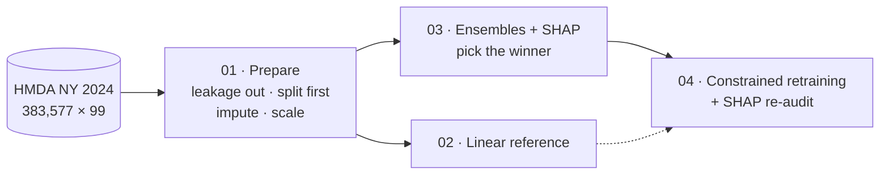
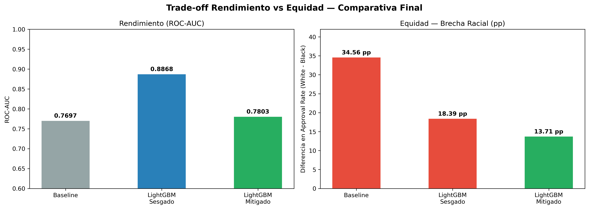
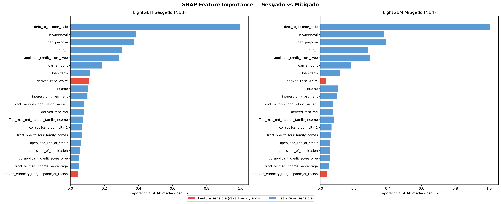
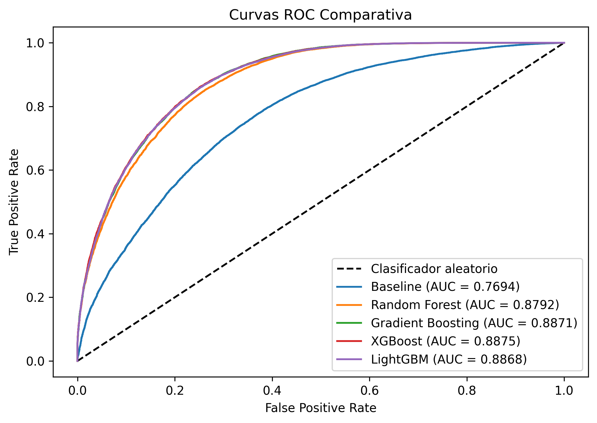

# HMDA-NY Credit Model Audit: Bias, Explainability and Mitigation


## Business Objective

A mortgage approval model has to be accurate and defensible under anti-discrimination rules (ECOA, Fair Housing Act). This project trains one on real 2024 New York HMDA data and puts it through the checks a compliance team would require before deployment: where the bias comes from, how much the model uses it, how much can be removed, and what that removal costs.

---

## Strategic Value & Architecture

### Experiment design

Three models are trained on the same split so that each isolates one effect:

| Model | Role in the experiment | Question it answers |
|---|---|---|
| **Logistic Regression** | Linear reference | How much bias does the data carry on its own? |
| **LightGBM, unconstrained** | Performance ceiling | What happens when a high-capacity model sees sensitive attributes? |
| **LightGBM + `ExponentiatedGradient`** | Constrained version of the same model | What does an `EqualizedOdds` constraint change, and at what price? |



### Design decisions

| Decision | Reason |
|---|---|
| Split **before** preprocessing | Imputer and scaler are fit on train only |
| Drop `lei`, `census_tract` | `lei` lets the model memorize which lenders approve more; `census_tract` is high-cardinality and covered by `county_code` and census variables |
| Remove post-decision columns (denial reasons, `interest_rate`, `rate_spread`, origination costs, `purchaser_type`) | They exist only after the decision: target leakage |
| Keep only `action_taken` 1 and 3 | The other outcomes are not active lending decisions |
| `RobustScaler`, `KNNImputer` (k=5), drop columns above 50% nulls | Skewed financial variables with capture errors; structural voids in the form should not be imputed |
| Keep sensitive columns in the CSVs | Fairness groups can be rebuilt in any notebook without reprocessing |
| `sample_weight_name='sample_weight'` and `_pmf_predict` | Needed to plug LightGBM into Fairlearn's randomized ensemble |
| SHAP over the weighted mean of `predictors_` and `weights_` | Explains the mitigated ensemble as a whole |

**Data card:** 283,332 applications × 80 features after filtering, ~74% approved / ~26% denied, stratified 80/20 split (226,665 train / 56,667 test), `RANDOM_STATE = 42`. Sensitive attributes (`derived_race`, `derived_sex`, `derived_ethnicity`) are used for auditing only. Source: [CFPB HMDA Data Browser](https://ffiec.cfpb.gov/data-browser/data/2024?category=states&items=NY).

---

## Key Results & Metrics

### The experiment ladder

| Model | Accuracy | F1 | ROC-AUC | Approval White | Approval Black | Racial Gap | TPR Gap |
|---|---|---|---|---|---|---|---|
| Logistic Regression | 0.7120 | 0.7874 | 0.7697 | 66.85% | 32.29% | 34.56 pp | 32.31 pp |
| LightGBM, unconstrained | 0.8621 | 0.9116 | 0.8868 | 85.25% | 66.86% | 18.39 pp | 5.20 pp |
| LightGBM + `ExponentiatedGradient` | 0.8622 | 0.9117 | 0.7803 | 84.13% | 70.42% | 13.71 pp | 1.67 pp |



Reading the ladder step by step:

* **Linear → LightGBM:** the gap halves (34.56 → 18.39 pp), but only because the model fits better overall. Nothing in it targets fairness.
* **Unconstrained → mitigated:** the gap falls by 4.68 pp and the TPR gap by 68%, at a cost of 10.65 pp of ROC-AUC. As a rough exchange rate, each point of gap closed cost ~2.3 points of AUC.
* **Decision quality is intact:** Accuracy and F1 move by less than 0.001, and the confusion matrices differ by under 30 cases per cell (false negatives 1,484 → 1,455, false positives 6,329 → 6,354). The cost sits in how well the model ranks probabilities.

### Effect on each sensitive axis

| Axis | Groups compared | Unconstrained gap | Mitigated gap |
|---|---|---|---|
| Race (constrained) | White vs. Black | 18.39 pp | 13.71 pp |
| Ethnicity | Not Hispanic vs. Hispanic | 13.14 pp | 13.09 pp |
| Sex | Male vs. Female | 1.10 pp | 0.91 pp |

The constraint targets `derived_race_White` only, and the table shows it: ethnicity does not move.

### What the model looks at



`derived_race_White` sits 8th in the unconstrained model (~0.10 mean |SHAP|) and drops to ~0.03 after mitigation. `debt_to_income_ratio`, `preapproval`, `loan_purpose` and `aus_1` remain the dominant features in both.

### Model selection



Random Forest, Gradient Boosting, XGBoost and LightGBM land within 0.008 ROC-AUC of each other (0.8792 to 0.8871). LightGBM was chosen because it trains in 1.90 s against ~320 s for Gradient Boosting, which matters when mitigation retrains the model repeatedly. Tuning: `GridSearchCV`, 108 combinations, 3-fold, `roc_auc`.

### Scope of the claims

* The residual 13.71 pp gap means mitigation reduces bias; it does not remove it.
* HMDA records what banks decided, not whether applicants were creditworthy, so the model learns historical decisions, bias included.
* `ExponentiatedGradient` returns a randomized classifier, so predictions carry some variance.
* Natural extensions: multi-attribute constraints, `ThresholdOptimizer`, reweighing and intersectional subgroups.

---

## Tech Stack

`Python 3.x` · `pandas` · `numpy` · `scikit-learn` · `lightgbm` · `xgboost` · `shap` · `fairlearn` · `matplotlib` · `seaborn`

---

## Repository Structure

```text
AA-PROYECTO-HMDA-NY/
├── 📁 data/                       # Git-ignored; regenerated by notebook 01
├── 📁 models/                     # Git-ignored; regenerated by notebook 03
│   ├── gradient_boosting.pkl
│   ├── lightgbm.pkl
│   ├── random_forest.pkl
│   └── xgboost.pkl
├── 📁 notebooks/
│   ├── 01_EDA_Limpieza.ipynb               # Audit, leakage removal, preprocessing
│   ├── 02_Modelo_Baseline.ipynb            # Logistic Regression + fairness baseline
│   ├── 03_Modelo_Sesgado_XAI.ipynb         # Ensembles + SHAP audit
│   └── 04_Modelo_Mitigado_XAI.ipynb        # Fairlearn mitigation + SHAP comparison
├── 📁 outputs/
│   └── images/                    # Exported charts
├── 📁 report/
│   ├── report.tex
│   └── report.pdf                 # Full technical report (Spanish)
├── 📄 .gitignore
├── 📄 hmda-presentacion.html      # Project presentation
├── 📄 README.md
└── 📄 requirements.txt
```

---

## Setup & Execution

```bash
git clone https://github.com/jcm204/aa-proyecto-hmda-ny.git
cd aa-proyecto-hmda-ny
pip install -r requirements.txt
```

1. Download the dataset from the [CFPB HMDA Data Browser](https://ffiec.cfpb.gov/data-browser/data/2024?category=states&items=NY) and save it as `data/state_NY.csv`.
2. Run `01_EDA_Limpieza.ipynb` end to end. It writes `data/train.csv` and `data/test.csv`, needed by every later notebook.
3. Run `02_Modelo_Baseline.ipynb` → `03_Modelo_Sesgado_XAI.ipynb` → `04_Modelo_Mitigado_XAI.ipynb`. Notebook 03 saves the trained ensembles to `models/`.

Full methodology and discussion: [`report/report.pdf`](report/report.pdf).

---

## References

**Fairness foundations**

1. Barocas & Selbst (2016). *Big Data's Disparate Impact*. California Law Review.
2. Hardt et al. (2016). *Equality of Opportunity in Supervised Learning*. NeurIPS.
3. Kleinberg et al. (2017). *Inherent Trade-Offs in the Fair Determination of Risk Scores*. ITCS.
4. Mehrabi et al. (2021). *A Survey on Bias and Fairness in Machine Learning*. ACM Computing Surveys.

**Mitigation**

5. Agarwal et al. (2018). *A Reductions Approach to Fair Classification*. ICML.
6. Bird et al. (2020). *Fairlearn: A Toolkit for Assessing and Improving Fairness in AI*. Microsoft Technical Report.

**Modelling and explainability**

7. Ke et al. (2017). *LightGBM: A Highly Efficient Gradient Boosting Decision Tree*. NeurIPS.
8. Lundberg & Lee (2017). *A Unified Approach to Interpreting Model Predictions*. NeurIPS.

---

## Collaborators

Developed as a collaborative project at the Universidad de Alicante, BSc in Artificial Intelligence Engineering (2025/26).

- Jesús Cano Moya
- Izan Cuesta Corbí
- Dennis García Solera
- Marcos Segurado Llopis
